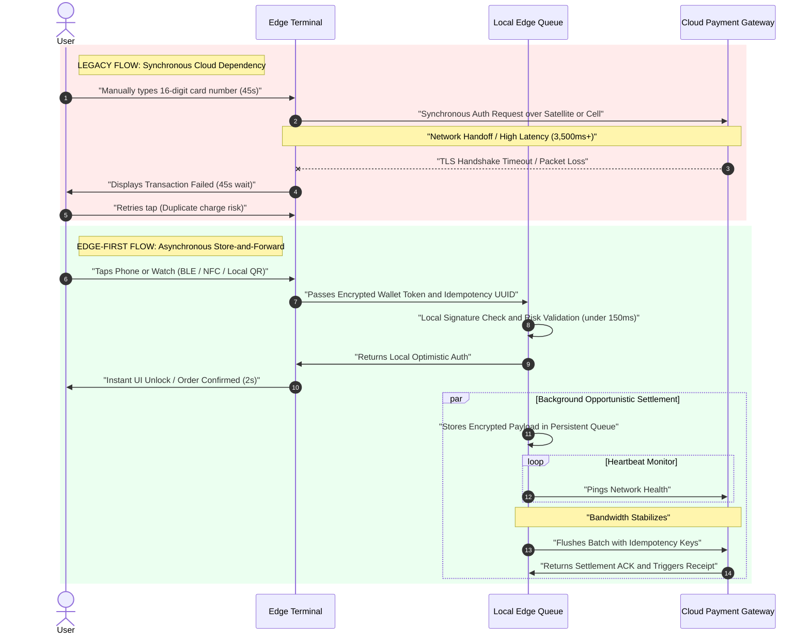

# edge-commerce-architecture
Relying on synchronous, real-time cloud API calls for payment gateway authorization in moving or bandwidth-constrained environments guarantees cart abandonment. To capture high-margin impulse revenue in captive environments, we must decouple the User Experience Layer from the Settlement Layer (which must be asynchronous and resilient).

